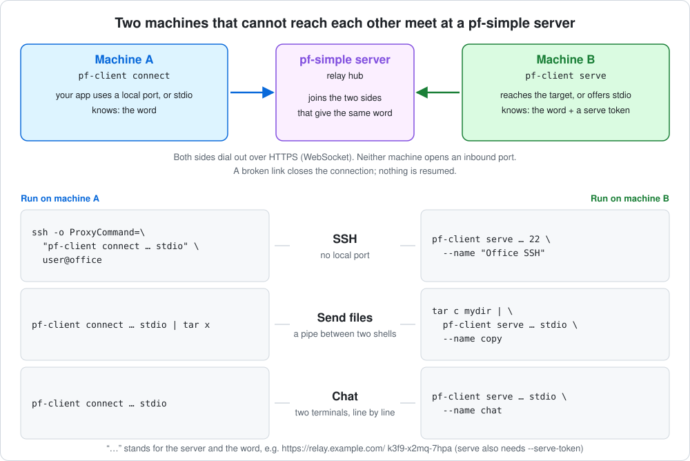

# pf-simple

A small TCP port forwarder that supports multiple mappings.

**Zero copy** on Linux.

## Screenshots


## Quick start

Give each mapping as `listen@target`, either as plain arguments or with
`--forward`/`-f`:

```sh
./pf-simple 8080@10.0.0.6                     # :8080 -> 10.0.0.6:8080
./pf-simple 8080@10.0.0.6:80 9030@db:9030     # two listeners
./pf-simple -f 127.0.0.1:4100@10.0.0.7:3306 --console 18222@secret
```

Defaults keep the common case short:

| You write | It means |
| --- | --- |
| `8080@10.0.0.6` | listen on every interface, port 8080; forward to `10.0.0.6:8080` |
| `127.0.0.1:4100@db:3306` | exactly those addresses |
| `9030@[2001:db8::6]` | IPv6 target (brackets required), port 9030 |
| `--console 18222` | console on `127.0.0.1:18222` only; use `:18222` for every interface |
| `--console 18222@secret` | console password `secret`; without `@...` it comes from `$PF_PASSWORD` |

Flags and mappings can come in any order. `pf-simple -h` prints the usage.
Anything more (names, connection caps, speed limits) goes in a
[configuration file](#configuration-file), started with `-c`/`--config`.

The two directions of a connection are copied independently. When one
direction reaches EOF, the forwarder half-closes the corresponding destination
socket so the other side can still send a final response. If the connection is
idle for 30 seconds after that half-close, both sockets are closed. Intentional
waits for bandwidth limits do not count as idle time. SIGINT and SIGTERM stop
the listeners.

## Docker

Images for `linux/amd64` and `linux/arm64` are published for every release
as `wushilin/pf-simple` on Docker Hub and `ghcr.io/wushilin/pf-simple`.
Tags are the version (`0.7.0`), the minor line (`0.7`) and `latest`.

Host networking is the simplest fit for a forwarder: listeners bind straight
on the host, including ones added later in the console, with no `-p` per
port. The arguments are the same as for the binary:

```sh
docker run -d --name pf-simple --restart unless-stopped --network host \
  wushilin/pf-simple 8080@10.0.0.6 9030@db:9030 --console 18222@secret
```

The console is then on `http://127.0.0.1:18222/pf/` of the host.

With a config file, mount a writable directory at `/data`; the console
writes listener changes back to the file:

```sh
mkdir -p pf-data
cp pf-simple.example.toml pf-data/pf-simple.toml   # edit it first
chmod 600 pf-data/pf-simple.toml
docker run -d --name pf-simple --restart unless-stopped --network host \
  -v "$PWD/pf-data:/data" \
  wushilin/pf-simple -c /data/pf-simple.toml
```

Without `--network host`, publish each listen port and make the console
listen on every interface inside the container (`:18222`, not
`127.0.0.1:18222`):

```sh
docker run -d -p 8080:8080 -p 18222:18222 \
  wushilin/pf-simple 8080@10.0.0.6 --console :18222@secret
```

The image runs as root so listeners can bind ports below 1024 on the host
network. Add `--user 65532:65532` to run unprivileged; low ports then fail
to bind on the host network, and a mounted `/data` must be writable by that
user.

## Configuration file

For anything beyond simple mappings, put the setup in a TOML file:

```sh
./pf-simple -c /etc/pf-simple.toml      # or --config /etc/pf-simple.toml
```

`-c`/`--config` cannot be combined with any other flag or with mappings on
the command line: `pf-simple -c pf.toml --forward 8080@x` exits with an
error naming `--forward`. Unknown keys are errors too, so a typo stops
pf-simple at startup instead of being silently ignored. The address
shorthand above works in the file as well.

```toml
# Optional web console; leave the table out to disable it.
[console]
listen = "127.0.0.1:18222"
password = "change-me"        # or leave out to use $PF_PASSWORD

[[forward]]
name = "HTTP"                 # optional; the console shows "HTTP [0.0.0.0:8080]"
listen = "0.0.0.0:8080"
target = "10.0.0.6:8080"

[[forward]]
name = "Doris MySQL"
listen = "0.0.0.0:9030"
target = "10.0.0.6:9030"
max_connections = 200
total_speed = "1GiB/s"
per_connection_max_speed = "15MiB/s"
```

Each `[[forward]]` takes:

| Key | Required | Meaning |
| --- | --- | --- |
| `listen` | yes | Address to accept connections on. |
| `target` | yes | Address to forward each connection to. |
| `name` | no | Label for the console and logs. Without it the listen address is shown. |
| `max_connections` | no | Most simultaneous connections. Further clients are refused with an immediate TCP reset and counted as "refused" in the console. Default: unlimited. |
| `total_speed` | no | Speed limit shared by all connections on this listener. Default: unlimited. |
| `per_connection_max_speed` | no | Speed limit for each connection. Default: unlimited. |
| `low_latency` | no | `true` copies every read at once instead of batching busy streams (see [Batching](#batching-busy-streams)). Default: `false`. |

Speed limits exist only in config files, not on the command line. When both
are set, both are enforced: a connection never exceeds its own cap, and all
connections together never exceed the total. Each limit applies to each
direction separately (client to target and target to client), like a
full-duplex link. Units are `B`, `KB`, `MB`, `GB` (1000-based), `KiB`, `MiB`,
`GiB` (1024-based), or bit rates `bit`, `Kbit`, `Mbit`, `Gbit` (also `Kbps`,
`Mbps`, `Gbps`); `/s` is optional, so `512B/s`, `14KiB/s`, `100Mbit` and
`1GiB/s` all work.

Limits keep the splice data path: pf-simple reserves bandwidth before sending
each chunk. Limited listeners use smaller chunks to keep the rate smooth.
On a Linux test host a listener with
`per_connection_max_speed = "40MiB/s"` held one iperf3 stream at 40.0 MiB/s,
and `total_speed = "100MiB/s"` held four streams at 100.0 MiB/s combined.

A config file may also hold only a `[console]` table and no forwards, since
the console can add them; with neither, pf-simple refuses to start.

The `[console]` table takes `listen` (required) and `password` (optional,
falling back to `$PF_PASSWORD`; empty means no password). If the file holds a
password and is readable by every user, pf-simple prints a warning; use
`chmod 600`. See [`pf-simple.example.toml`](pf-simple.example.toml) for a
commented example.

To run it as a systemd service without a console, keep the file root-owned
with `chmod 600` and pass it in with `LoadCredential`, so the unprivileged
service user can read it while nobody else can:

```ini
[Service]
LoadCredential=pf-simple.toml:/etc/pf-simple.toml
ExecStart=/usr/local/bin/pf-simple --config %d/pf-simple.toml
DynamicUser=yes
Restart=always
```

With a `[console]`, the console writes listener changes back to the file, so
it must live somewhere writable instead; see
[Managing listeners from the console](#managing-listeners-from-the-console).

## Managing listeners from the console

What the console may change depends on how pf-simple was started:

| Action | Command line | Config file (`-c`) |
| --- | --- | --- |
| Disconnect a pipe (Stop on a row) | yes | yes |
| Stop / Start a listener | yes, until restart | yes, saved |
| Add a listener | no | yes |
| Edit a listener (every field) | no | yes, while stopped |
| Delete a listener | no | yes, while stopped |

On the command line, a console alone is refused, because it could not add
anything (unless `--tunnel` turns the relay hub on). In a config file, `[console]` alone is fine: start it empty and add
listeners from the browser. Every change is written back to the config file.

```toml
[console]
listen = "0.0.0.0:20000"
password = "change-me"
# Optional fences for listeners added or edited in the console.
# An omitted one means no restriction.
allow_target_hosts = ["10.0.0.6", "10.0.0.0/24", "db.internal"]   # IPs, CIDRs, exact hostnames
allow_target_ports = "80, 8080, 9030, 3000-3999"
allow_bind_hosts = ["0.0.0.0", "127.0.0.1"]                       # "0.0.0.0" or "::" allows "all interfaces"
allow_bind_ports = "18000-19999"
```

- **Fences.** A hostname is matched by name only and never resolved, so DNS
  cannot redirect it. Without any fences, anyone with the console password can
  make the host relay to any address it can reach, so set at least
  `allow_target_hosts` on a host that is exposed.
- **Stop** stops accepting, resets every open pipe, and waits for them to
  close before it reports success. A stopped listener is saved as
  `enabled = false`.
- **Edit and Delete** need a stopped listener. Edit keeps the listener's
  counters; it stays stopped until you start it.
- **Saving** rewrites the whole file atomically (temporary file, fsync,
  rename) with mode 600. `[console]` is written back exactly as loaded; a
  password that came from `$PF_PASSWORD` is never written into the file.
  Comments are not kept.
- **Startup.** In config mode a listener whose port is busy shows "failed to
  start" in the console while the others keep running. On the command line a
  busy port stops pf-simple, as before.
- **Writable location.** With a `[console]`, pf-simple checks at startup that
  it can create files in the config file's directory and refuses to start
  otherwise. Under systemd, keep the file in a `StateDirectory` (see
  [Running under systemd](#running-under-systemd)).

## Relay hub: ad-hoc tunnels with pf-client

Two machines that cannot reach each other, but can both reach a pf-simple
server over HTTPS, can meet there. One runs `pf-client serve`, the other
`pf-client connect`, and the server joins them when they give the same
word. Both dial out; neither opens an inbound port.



In the examples the server is `https://relay.example.com/`, machine B is
the one that serves and machine A the one that connects. `serve` needs a
serve token from the server's admin, here in `$PF_SERVE_TOKEN`.

### Use case: a port on another machine

B can reach a service (its own sshd here; `192.168.1.20:5432` would work
the same). A gets it on a local port.

```sh
# machine B
pf-client serve https://relay.example.com/ 22 --name "Office SSH"
# ... word: k3f9-x2mq-7hpa   (connect with: pf-client connect https://relay.example.com/ k3f9-x2mq-7hpa <listen>)

# machine A
pf-client connect https://relay.example.com/ k3f9-x2mq-7hpa 2222
ssh -p 2222 user@127.0.0.1
```

Both commands stay up and recover by themselves, and the port takes any
number of connections, so this suits a tunnel you leave running.

### Use case: SSH without a local port

With `stdio` as the listen address, `connect` carries one connection over
its stdin/stdout and exits, which is what ssh's `ProxyCommand` wants. B runs
the same `serve` as above; A needs nothing running beforehand:

```sh
# machine A
ssh -o ProxyCommand="pf-client connect https://relay.example.com/ k3f9-x2mq-7hpa stdio" user@office
```

For everyday use, put it in `~/.ssh/config`, and `ssh office`, `scp` and
`rsync` all go through the tunnel:

```
Host office
    User user
    ProxyCommand pf-client connect https://relay.example.com/ k3f9-x2mq-7hpa stdio
```

ssh starts one pf-client per connection. In this mode pf-client prints
nothing unless the connection fails, and it cannot ask about an untrusted
certificate, so the server needs a valid one (or `-k`). The host name after
`user@` only names the entry in `known_hosts`; the tunnel decides where the
connection goes.

### Use case: send files

`serve` takes `stdio` as its target too. Then there is no service at all:
what one side writes to pf-client, the other reads from it, like a pipe
between two shells.

```sh
# machine B: send a directory
tar c mydir | pf-client serve https://relay.example.com/ stdio --name copy
# ... word: k3f9-x2mq-7hpa   (connect with: pf-client connect https://relay.example.com/ k3f9-x2mq-7hpa stdio)

# machine A: receive it
pf-client connect https://relay.example.com/ k3f9-x2mq-7hpa stdio | tar x
```

A single file is `serve ... stdio < file` and `connect ... stdio > file`.
It works the other way round as well, since the stream is two-way:
`serve ... stdio | tar x` on B receives what `tar c mydir | pf-client
connect ... stdio` sends from A. The word and the log go to stderr, so only
the data is on stdout. Both sides exit when the stream ends, with status 0
if it ended cleanly and 1 if a link broke, so check the status before
trusting the copy.

### Use case: chat

The same pipe with a terminal on each side: every line typed on one
appears on the other. Ctrl-D ends your side; the chat is over when both
have.

```sh
# machine B
pf-client serve https://relay.example.com/ stdio --name chat
# machine A
pf-client connect https://relay.example.com/ k3f9-x2mq-7hpa stdio
```

A stdio `serve` is one stream between two people. It waits (registering
again if it loses the server) until the first connection arrives, carries
that one and exits; another that arrives meanwhile is refused. Stdin cannot
be read twice, so nothing is retried once the connection has started.

### Words, tokens and the server

`serve` made up the word and printed it; give your own as
`serve <server> <word> <target>` to keep the same one across restarts. A
wrong word gets `access denied`; the right one gets
`connected; listening on 127.0.0.1:2222`.

Up to three secrets are involved:

| Secret | Who has it | What it is for |
| --- | --- | --- |
| Serve token | One holder: whoever may run `serve` with it | Permission to register tunnels on this server. Without one, anyone who can reach the server could relay through it. |
| Word | Both sides of one tunnel | Names the tunnel. |
| Client token (optional) | Both sides of one tunnel | A second secret the serving side may ask for. `connect` then needs it as well as the word. |

To ask for a client token, give `serve` one, and give `connect` the same:

```sh
pf-client serve   https://relay.example.com/ 22 --name "Office SSH" --client-token correct-horse
pf-client connect https://relay.example.com/ k3f9-x2mq-7hpa 2222   --client-token correct-horse
```

It is 8 to 128 printable characters without spaces, and can also come from
`$PF_CLIENT_TOKEN` or `client_token` in the config file. The server checks it before anything reaches the serving side: it
keeps only the token's SHA-256, which `serve` registers, and a missing or
wrong token gets the same `access denied` as a wrong word, counted against
the sender's address like any other wrong guess. The console marks such a
tunnel **Client token**.

A word is three groups of four letters or digits, like `k3f9-x2mq-7hpa`,
and case does not matter. A generated word (from `serve` without one, or
`pf-client word`) is random, 59 bits, and leaves out `0`, `o`, `1`, `i` and
`l`, so it is easy to read out. Prefer a generated word to an invented one:
anyone who guesses a word can connect to its tunnel. A serve token is 32 to
128 printable characters; the console generates them.

Every tunnel also has a name, which `serve` must give (`--name "Office
SSH"`). It is how the tunnel appears in the console and the flow log.

The hub is multi-tenant: every holder gets their own named serve token.
The first token to register a word owns it for good: no other token can
serve that word until an admin clears the binding in the console. Nothing
caps how many tunnels or connections a token has.

The console's **Relay hub** tab has a **Settings** card with two switches,
and a **Details** card with the tokens and tunnels. Both switches are saved
in the config file's `[tunnel]` table, which the console adds if the file
has none:

| Switch | In the file | Meaning |
| --- | --- | --- |
| Relay hub | `enabled` | Off (the default without a `[tunnel]` table), the tunnel endpoints answer 404, as on a server without a hub, and the tab shows only this switch. Turning it off ends every tunnel; tokens and bindings are kept. |
| Enable anonymous serve | `anonymous_serve` | `pf-client serve` needs no serve token. Off by default. |

```toml
[tunnel]
enabled = true
anonymous_serve = false
```

With anonymous serve on, anyone who can reach the server can relay through
it, so turn it on only where that is meant. A `serve` without a token then
registers as the built-in tenant `anonymous`, listed last in the console.
Because that tenant is everybody, it works a little differently: a word
that is being served cannot be taken over by a second anonymous `serve`
(it is told to wait, and gets the word once the first is gone), all
anonymous words together share one token's limit of 256, and turning the
switch off ends those tunnels and frees their words. A token that is given
must still be right, and a word bound to a token cannot be served
anonymously.

**Add token** generates a 40-character serve token and shows it once. The
config file gets only its SHA-256, so a leaked config file does not let
anyone serve, and a lost token is replaced with **New token** rather than
recovered:

```toml
[[tunnel.tenant]]
name = "alice-laptop"
token_sha256 = "5f2b…"     # written by the console
```

**New token** ends that holder's tunnels and keeps their words; **Delete**
ends them and frees the words.

Without a config file, `--tunnel <serve-token>` (repeatable) turns the hub
on with fixed tokens named `cli-1`, `cli-2`, ...; they cannot be changed in
the console:

```sh
pf-simple --console 18222@secret --tunnel "$PF_SERVE_TOKEN"
```

The hub is served on the console's own listener, under `/pf/api/tunnel/`;
there is no separate port. Tunnels are https only, at both ends:
`pf-client` refuses an `http://` server, and the hub refuses a tunnel
request that did not arrive over TLS, so the word and the tokens never
travel in the clear. There are two ways to give it TLS:

- **pf-simple's own**, with nothing else to run. See
  [HTTPS without a proxy](#https-without-a-proxy) below.
- **A TLS reverse proxy in front**, as for the [console](#web-console). It
  must pass the WebSocket `Upgrade` headers and set
  `X-Forwarded-Proto: https`, which is how the hub knows.

### HTTPS without a proxy

The console's listener can serve https itself. It is off unless you turn it
on, in the **Relay hub** tab's Settings card or in `[console]`:

```toml
[console]
listen = "0.0.0.0:18222"
tls = "self_signed"            # or "directory"; leave out for plain http
tls_dir = "certs"              # where the files are; this is the default
tls_names = ["relay.example.com"]
```

| `tls` | What pf-simple does |
| --- | --- |
| `"self_signed"` | It is its own certificate authority. In `tls_dir` it makes `ca.key`, `ca.pem`, `server.key` and `server.pem`, and renews both certificates on its own, at start and while running (the server's every eight months, the CA's every eight years). Only the certificates are ever replaced, never the keys, so whoever trusts `ca.pem` keeps trusting the server through every renewal. |
| `"directory"` | It serves your `server.pem` (certificate, then its chain) with `server.key` from `tls_dir`, and reads them again when they change, within half a minute. Replace the files by hand or let whatever renews them do it; no restart. A replacement that cannot be read is logged and the old certificate stays in use. |

`tls_dir` is relative to the config file unless it is absolute. A
self-signed certificate always names `localhost`, the machine's host name
and its IPv4 addresses; put the names clients really use, and any fixed
IPv6 address, in `tls_names`. It is issued again (same key) when that list
grows.

Clients trust a self-signed server through its CA. Copy `ca.pem` to them
once:

```sh
pf-client serve   https://relay.example.com:18222/ 22 --name "Office SSH" --ca ca.pem
pf-client connect https://relay.example.com:18222/ k3f9-x2mq-7hpa stdio --ca ca.pem
```

With `--ca` (or `ca = "ca.pem"` in the client's config file) nothing is
asked and nothing is skipped: the certificate must come from that CA and
name the host in the URL. Without it, pf-client shows the fingerprint and
asks, or `-k` skips the check. A browser warns about the console until
`ca.pem` is imported as a trusted authority.

Changing the mode in the console switches the listener in place: the
certificate is prepared first, so a directory without a usable certificate
changes nothing, connections that are open stay as they are, and the page
moves itself to the new `http://` or `https://` address. Behind a reverse
proxy leave it off, or the proxy can no longer reach pf-simple. From the
command line, `--console-tls` is the self-signed mode with `./certs`.
 With a config file, the bindings of words to tokens are kept next to
it as `<name>.relay.json` (mode 600; the words in it are secrets). Started
from the command line, they last until a restart.

`pf-client` arguments:

| Argument | Meaning |
| --- | --- |
| `<server>` | The pf-simple server: `https://host[:port]/`. The `/pf/api/tunnel` path is added for you. |
| `<word>` | The tunnel's word, the same on both sides. `serve` may leave it out. |
| `<target>` (serve) | `host:port`, or a port alone for `127.0.0.1`. `stdio` (any case) or `-` offers pf-client's own stdin/stdout instead: it waits for one connection, carries it, and exits when it ends (exit status 1 if it broke). Further connections meanwhile are refused. |
| `<listen>` (connect) | `host:port`, or a port alone to listen on `127.0.0.1` only. `stdio` (any case) or `-` carries one connection over stdin/stdout and then exits, for `ssh -o ProxyCommand='pf-client connect https://relay.example.com/ <word> stdio' user@host`; nothing listens locally, and it is silent unless the connection fails. |
| `-n`, `--name` | The tunnel's name in the console. `serve` needs it. |
| `-s`, `--serve-token` | Your serve token, for `serve`. Defaults to `$PF_SERVE_TOKEN`. Without one the registration is anonymous, which works only where the server allows it. |
| `-t`, `--client-token` | A second secret on top of the word. Given to `serve`, `connect` needs the same one. Defaults to `$PF_CLIENT_TOKEN`. |
| `--ca` | Trust the server's certificate if this CA issued it: a PEM file, such as `ca.pem` of a pf-simple that [serves https itself](#https-without-a-proxy). |
| `-k`, `--insecure` | Do not verify the server's certificate. |
| `-c`, `--config` | Read everything from a TOML file instead; cannot be combined with other arguments. |

With `-c`, the parameters come from a file, and one file can serve both
commands (see [`pf-client.example.toml`](pf-client.example.toml)):

```toml
server = "https://relay.example.com/"
word = "k3f9-x2mq-7hpa"
target = "192.168.44.132:22"     # for: pf-client serve -c client.toml
name = "Office SSH"
serve_token = "..."              # or $PF_SERVE_TOKEN; chmod 600 the file
client_token = "..."             # optional, both commands; or $PF_CLIENT_TOKEN
listen = "2222"                  # for: pf-client connect -c client.toml
```

Without `-k`, a certificate that does not verify (self-signed, private CA)
is shown with its subject and SHA-256 fingerprint, and `pf-client` asks
whether to trust it; a yes pins that exact certificate for the run. When it
cannot ask (no terminal, or `-` mode), it refuses.

How it behaves:

- Both commands are meant to be started once and left. `serve` registers
  again whenever it loses the server, pausing 1s, 2s, 4s ... up to 30s
  between attempts and starting over from 1s once it has been up for a
  minute. `connect` keeps listening whether or not the tunnel is up and logs
  when that changes. Only a mistake stops them: a malformed argument, or
  the server refusing the very first `serve` (a wrong serve token, or a
  word that belongs to another token).
- Whatever breaks, at any point of the chain, every party lets go: the side
  that sees the break at once, the far side after the 30 second idle rule.
  A link that goes silent without closing is noticed after 30 seconds
  without a keepalive (one is sent every 10). Each client logs the end of
  every connection with its lifetime, the bytes each way, and the hop that
  broke, named the same at both ends:

  ```
  connection 61578a5b closed after 2h3m10s: app->target 86 B, target->app 3.0 MiB; the target reset its connection to pf-client serve
  ```

- Each forwarded TCP connection is one WebSocket from each side, joined at
  the hub, with its own connection id: both clients log it and the console
  shows it. Bytes travel
  in frames of up to 64 KiB; a half-close (FIN) travels too, with the same
  30 second idle rule as any other pipe.
- Nothing is resumed or replayed. If any link breaks, that connection is
  closed on both ends, exactly as a broken TCP connection would be, and
  whatever was using it connects again. No byte is ever delivered twice or
  skipped.
- `serve` reconnects on its own when it loses the server. The tunnel's open
  connections end with the lost link; `connect` keeps listening and new
  connections work as soon as `serve` is back.
- The hub sees the bytes it relays, and this path is not zero-copy. Use it
  for protocols that bring their own encryption, such as ssh.
- Guessing is slow by design. A wrong word or serve token is answered
  `access denied` after a one-second delay, and a source address refused 30
  times within a minute gets no further answers, right or wrong, until the
  minute has passed (429). Behind a reverse proxy on the same host or
  private network the address is the one the proxy reports in
  `X-Forwarded-For`, so the proxy must set it; a client that reaches
  pf-simple directly is counted by its own address.
- A token may have up to 256 words bound to it. Past that, the word it
  served longest ago and is not serving now is released, so a `serve` that
  makes up a new word at every start cannot fill the hub. A server holds up
  to 10,000 tokens.

The **Relay hub** tab has three levels. Each token is a group; under it are
the backends it is serving now, each shown as `word → target` with where it
is served from, its speed each way and totals; and under each backend are
its connections, each with a state: **Active** (green), **Half closed**
(yellow: one side has finished sending) or **Closed** (red). A closed
connection stays listed for 30 seconds in the page that saw it close, then
goes. A backend is listed from the moment `serve` registers
it, before anyone connects, and a token that is serving opens on its own.
Words bound to the token that nobody is serving are listed after them.
**Stop** resets one connection, **Reset** ends a tunnel
and its connections (the serving side comes back on its own), and **Clear
binding** frees a word for whichever token registers it next. The tab shows
the words in full, so treat console access as access to every tunnel.

## Running under systemd

```ini
# /etc/systemd/system/pf-simple.service
[Unit]
Description=pf-simple TCP port forwarder
After=network-online.target
Wants=network-online.target

[Service]
Type=simple
StateDirectory=pf-simple
ExecStart=/usr/local/bin/pf-simple --config /var/lib/pf-simple/pf-simple.toml
DynamicUser=yes
Restart=always
RestartSec=2
NoNewPrivileges=yes

[Install]
WantedBy=multi-user.target
```

`DynamicUser=yes` runs pf-simple as a throwaway unprivileged user, and
`StateDirectory=pf-simple` gives that user a writable
`/var/lib/pf-simple/` for the config file, which the console rewrites. Let
systemd create the directory rather than making it yourself: on a host with
SELinux enforcing, systemd cannot adopt a directory that already exists
there. So, in order:

```sh
systemctl daemon-reload
systemctl start pf-simple          # fails on the missing config, but creates the directory
systemctl stop pf-simple
install -m 0600 pf-simple.toml /var/lib/pf-simple/pf-simple.toml
chown --reference=/var/lib/private/pf-simple /var/lib/pf-simple/pf-simple.toml
systemctl enable --now pf-simple
```

`/var/lib/pf-simple` is a symlink into root-only `/var/lib/private/`, so
only root and the service can read the file (it holds the console
password). Root can edit it by hand while the service is stopped. If you
run without a console, a read-only file passed in with `LoadCredential=`
works too, as shown in [Configuration file](#configuration-file).

Ports below 1024 need `AmbientCapabilities=CAP_NET_BIND_SERVICE` in the
`[Service]` section, because the unprivileged user cannot bind them.

## Web console

Add `--console` (or a `[console]` table in the config file) to serve a live
dashboard:

```sh
./pf-simple --forward 0.0.0.0:8080@10.0.0.6:8080 --console 127.0.0.1:18222@xyz123
```

The value is `listen-address[@password]`. Without a password after `@`, the
password comes from `$PF_PASSWORD`; if that is empty too, the console is open
to anyone who can reach it.

Everything the console serves, the page, its assets and the `api/` endpoints,
lives under `/pf/`, so open `http://127.0.0.1:18222/pf/`. The bare `/`
redirects there; nothing else is served. The session cookie is scoped to
`/pf` as well. This lets a reverse proxy mount the console next to other
applications by path without rewriting anything:

```nginx
location /pf/ {
    proxy_pass http://127.0.0.1:18222;
    proxy_http_version 1.1;
    proxy_set_header Upgrade $http_upgrade;     # the live view is a WebSocket
    proxy_set_header Connection "upgrade";
    proxy_set_header Host $host;
}
```

The page builds its WebSocket URL from its own location, so it works at
whatever host and scheme the proxy presents. The `Origin` of the handshake
must match the `Host` the proxy forwards, hence `Host $host` above.

What it shows (the build version sits next to the name in the top bar;
`pf-simple --version` prints it too):

- A summary strip: active pipes, accepted connections, current throughput in
  each direction, bytes transferred, uptime, and a two-minute throughput chart.
- One table per listener (`listen → target`, or `name [listen] → target`)
  with a sparkline, live rates and totals, plus its connection cap and speed
  limits when set. Expand it to list its active pipes (forwarded connections), newest
  first, with client address, age, TCP state (`ESTABLISHED`, `CLIENT FIN`,
  `UPSTREAM FIN`, `CLOSING`, `RESET`) and per-direction rates.
- Expand a pipe to see both legs, client ⇄ pf-simple and pf-simple ⇄
  upstream, with bytes counted in all four directions, half-close markers and
  bytes still in flight.
- A filter box that matches addresses, ports and `#id`.
- **Stop** on each pipe (click twice to confirm) resets it: both sockets close
  with `SO_LINGER 0`, so both peers get a TCP RST.
- Per-listener **Stop/Start**, and in config mode **Add listener**, **Edit**
  and **Delete** (see [Managing listeners from the console](#managing-listeners-from-the-console)).
- A **Flow log** tab: every connection from accept to close, newest first,
  including ones that never became pipes. Each row shows the listener,
  client, upstream, start time, duration, bytes each way and how it ended:
  `OPEN`, `CLOSED`, `RESET` (from the console, or its listener stopped),
  `IDLE TIMEOUT`, `FAILED` (target unreachable) or `REFUSED`
  (`max_connections`, or the listener was stopping). Hover a result for the
  reason. Filter by text or result, pause the view, or reset an open
  connection from its row. The last 2000 ended connections are kept in
  memory, so the log starts filled when you open it.
- A **Relay hub** tab, to turn the hub on and off and watch it (see
  [Relay hub](#relay-hub-ad-hoc-tunnels-with-pf-client)).
- An **API** tab: Swagger UI over the [REST API](#rest-api), to read the
  docs and try each call live with the page's session.

How it stays light:

- The server pushes state over a WebSocket only when something changed, at
  most once every 400 ms. An idle forwarder sends nothing but a ping every
  30 seconds. The page never polls.
- Each push is serialized once and handed to every open tab through a
  bounded broadcast queue
  ([go-named-queue](https://github.com/wushilin/go-named-queue)). The queue
  keeps 8 frames and drops the oldest when full, so a tab on a slow link
  misses stale frames instead of slowing the others, and nothing is
  serialized at all while no tab is open.
- Byte counters are per-pipe atomics. Live pipes sit in one registry whose
  mutex is only taken to add, remove or list them, so the console does not
  slow the copy path (see the benchmark below).
- A page left open forever uses bounded memory. Chart history is a fixed ring
  of 120 points, rate samples are capped, state for a closed pipe is dropped
  as soon as it disappears, at most 200 rows per listener are drawn, and each
  push carries at most the 500 newest pipes per listener (the true count is
  still shown).
- If the connection drops, the page reconnects on its own with backoff.

Everything the page needs (HTML, CSS, JavaScript, logo, Swagger UI) is compiled into the
binary with `go:embed`. It loads nothing from other sites, and the
Content-Security-Policy (`default-src 'self'`) makes the browser refuse
anything external. A test enforces both.

Security notes: the console speaks plain HTTP, so the password and session
cookie cross the network unencrypted. Bind it to `127.0.0.1` and use an SSH
tunnel (`ssh -L 18222:127.0.0.1:18222 host`), or keep it on a trusted network.
Sessions use an `HttpOnly`, `SameSite=Strict` cookie that lasts 12 hours and
are kept in memory, so restarting the forwarder signs everyone out. Logout and
session expiry also close that session's open WebSocket connections. Every
state-changing request needs a custom header, WebSocket connections from
other origins are refused, and a wrong password is answered after a one-second
delay.

### Flow log

The Flow log tab has its own WebSocket (`/pf/api/flows`), open only while
the tab is showing. Each connection's open and close events go to a second
broadcast queue (4096 events, drop-oldest), and nothing is built while no
page watches. Every 5 seconds the page also gets the authoritative list of
open connections, which repairs any event a slow page missed. Closed
connections live in a fixed ring of 2000 slots written with one atomic add,
so recording one never takes a lock.

### REST API

Everything the console does is also a JSON API under `/pf/api/`, described
by `/pf/openapi.json` and browsable in the console's API tab (or at
`/pf/swagger/`).

| Method & path | What it does |
|---|---|
| `GET /pf/api/health` | Liveness and build version; needs no authentication |
| `GET /pf/api/stats` | Totals: uptime, listeners, active connections, bytes |
| `GET /pf/api/policy` | Whether management is on, and the `allow_*` fences |
| `GET /pf/api/listeners` | Every listener with its counters |
| `POST /pf/api/listeners` | Add, start and save a listener |
| `POST /pf/api/listeners/validate[?id=N]` | Check a spec as add (or edit of N) would, without changing anything |
| `GET /pf/api/listeners/{id}` | One listener |
| `PUT /pf/api/listeners/{id}` | Edit a **stopped** listener (409 while running) |
| `DELETE /pf/api/listeners/{id}` | Delete a **stopped** listener |
| `POST /pf/api/listeners/{id}/start`, `/stop` | Start or stop it |
| `GET /pf/api/listeners/{id}/connections` | Its open connections |
| `GET /pf/api/connections[?listener=N]` | Every open connection, with live byte counters |
| `GET /pf/api/connections/{id}` | One open connection |
| `DELETE /pf/api/connections/{id}` | Reset it (TCP RST both ways) |
| `GET /pf/api/flows[?since=ms]` | Flow log as JSON; upgraded to a WebSocket, the live stream |
| `GET /pf/api/relay` | The relay hub's tokens (`tenants`), words, tunnels and their connections |
| `POST /pf/api/relay/{id}/reset`, `/clear` | End a word's tunnel, or also clear its binding to a token |
| `POST /pf/api/relay/tenants` | Add a named token (`{"name": "..."}`); answers with the serve token, once |
| `POST /pf/api/relay/tenants/{name}/rotate`, `/delete` | Replace a serve token, or delete it |

Authenticate with the console password in an `X-API-Token` header, or with
a console session cookie. A request that changes something must also carry
`X-PF-Console: 1` or `X-API-Token`. A browser cannot add either header to a
cross-site request, which is what stops cross-site request forgery. A wrong
token gets its 401 after a one-second delay, the same as a wrong password at
sign-in.

```sh
T='X-API-Token: secret'
curl -H "$T" http://127.0.0.1:18222/pf/api/listeners
curl -H "$T" -X POST -d '{"name":"web","listen":"18080","target":"10.0.0.6:8080"}' \
     http://127.0.0.1:18222/pf/api/listeners
curl -H "$T" -X POST http://127.0.0.1:18222/pf/api/listeners/2/stop
curl -H "$T" -X PUT -d '{"name":"web","listen":"18080","target":"10.0.0.7:8080"}' \
     http://127.0.0.1:18222/pf/api/listeners/2
curl -H "$T" -X POST http://127.0.0.1:18222/pf/api/listeners/2/start
```

The older routes the console page uses (`POST /pf/api/listeners/{id}/edit`,
`/delete`, `POST /pf/api/pipes/{id}/stop`, `GET /pf/api/state`) still work.
Swagger UI 5.17.14 is vendored under `console/swagger/` (Apache-2.0, see its
`LICENSE`).

## Data path: zero-copy on Linux

On Linux, pf-simple moves bytes with `splice(2)`, so payload data never
enters user space:

```
client socket ──splice──▶ kernel pipe (64 KiB) ──splice──▶ upstream socket
```

Each direction of each connection owns one kernel pipe. pf-simple asks the
kernel to move up to 64 KiB from the source socket into the pipe, then from
the pipe into the destination socket. The data stays in kernel memory the
whole way, so there is no `read()` into a Go buffer and no `write()` back
out, and two system calls move each chunk. "Zero-copy" here means no copies
into or out of user space; the kernel may still copy internally, depending on
the network driver.

The sockets stay non-blocking. When a socket has no data or no room, the
goroutine parks in Go's network poller instead of holding a thread, so
thousands of idle connections cost almost nothing. Closing a socket from
another goroutine (Stop in the console, the idle timeout, shutdown) wakes it
immediately.

Go's own `TCPConn.ReadFrom` also splices, but it returns only after its byte
limit or EOF, so the console would see a slow trickle of traffic only in large
steps and the idle timer would misfire. pf-simple runs its own splice loop and
counts every chunk, which keeps the console accurate and the half-close idle
timeout correct. Speed limits keep this path too: pf-simple waits between
chunks instead of switching to a buffer.

In numbers, on a Linux test host (see the benchmark below), splice forwarded
a single localhost stream 20 to 35% faster than a user-space copy, and four
streams at about the speed of a direct connection. `strace` during a transfer
shows only `splice` calls carrying data, no `read` or `write`.

macOS, FreeBSD and Windows have no socket-to-socket splice, so there
pf-simple uses a read/write loop with a 64 KiB buffer.

### Batching busy streams

A stream that arrives a few packets at a time costs a wakeup and two splices
per chunk, however small the chunk. So on Linux, when a read comes back short
in the middle of a stream, pf-simple waits 5 ms, tops the pipe up once, and
copies what is there. Each direction decides on its own, from its own reads:

- A read that fills the pipe is copied at once. From a network card the pipe
  holds 16 packets (about 23 KB at MTU 1500), locally 64 KiB; pf-simple
  measures which every 100 ms.
- A wait that catches nothing turns waiting off: nothing kept arriving, as
  with a request waiting for its reply. Every 100 ms it is tried again.
- Reads more than 5 ms apart are separate messages and never wait.

Over a 1 Gbit/s LAN, 10 connections at 20 Mbit/s each used 4.5 s of CPU in
12 s without batching and 1.1 s with it, with 7 times fewer system calls; one
connection still ran at line rate. Request/reply round trips are unchanged
except for the 100 ms retry, which can hold one message 5 ms. Set
`low_latency = true` on a listener (or tick Low latency in the console) when
that matters more than CPU.

## Performance test (localhost to localhost)

Run an `iperf3` server, put the forwarder in front of it, and point the
client at the forwarded port:

```sh
iperf3 -s -p 5201 &
./pf-simple --forward 127.0.0.1:5202@127.0.0.1:5201 &

iperf3 -c 127.0.0.1 -p 5201 -t 10        # baseline, no forwarder
iperf3 -c 127.0.0.1 -p 5202 -t 10        # through pf-simple
iperf3 -c 127.0.0.1 -p 5202 -t 10 -R     # reverse direction
iperf3 -c 127.0.0.1 -p 5202 -t 10 -P 4   # 4 parallel streams
```

Sample results, 10 second runs:

| Host | Path | 1 stream | 1 stream `-R` | 4 streams |
| --- | --- | --- | --- | --- |
| Linux 6.12 x86_64, 12 cores | direct (no forwarder) | 59.1 Gbit/s | — | 59.3 Gbit/s |
| | pf-simple, splice | **35.8 Gbit/s** | **33.8 Gbit/s** | **62.7 Gbit/s** |
| | pf-simple, 64KiB buffer | 28.3 Gbit/s | 29.2 Gbit/s | 51.5 Gbit/s |
| | previous `io.Copy` version | 29.5 Gbit/s | 25.6 Gbit/s | 45.9 Gbit/s |
| macOS, Apple Silicon | direct (no forwarder) | 92.1 Gbit/s | — | — |
| | pf-simple, 64KiB buffer | 36.1 Gbit/s | — | — |

The forwarded path uses two loopback hops instead of one, so a single stream
cannot match the direct baseline. With 4 streams the forwarder spreads work
across more cores and keeps up with the direct path.
